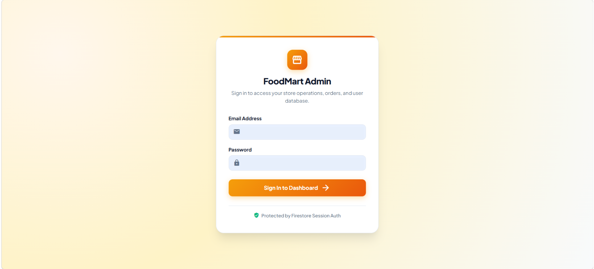
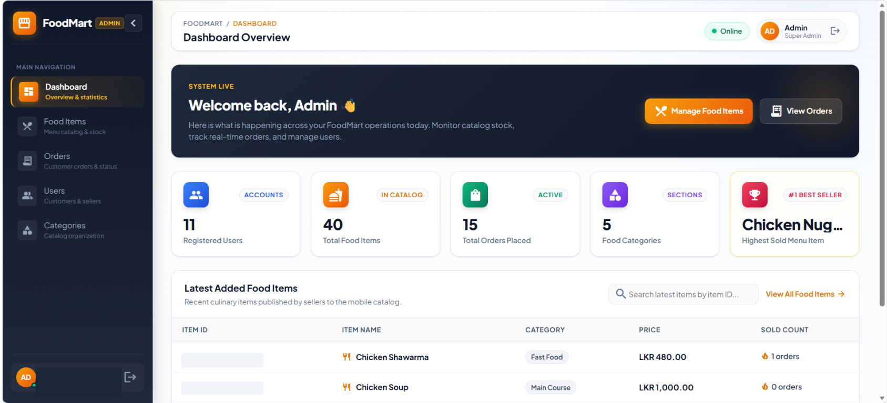
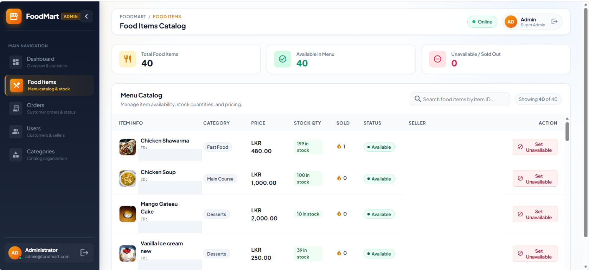
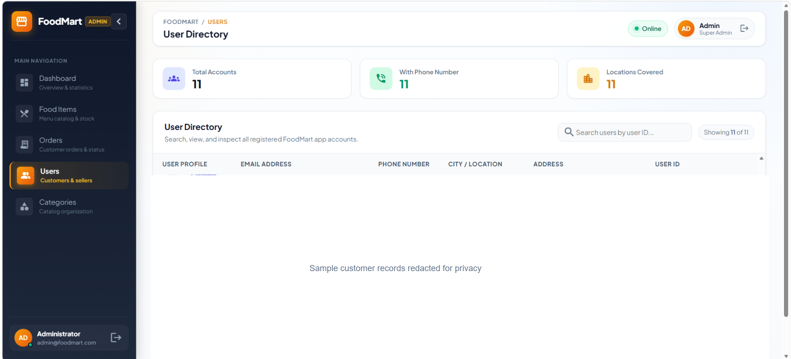
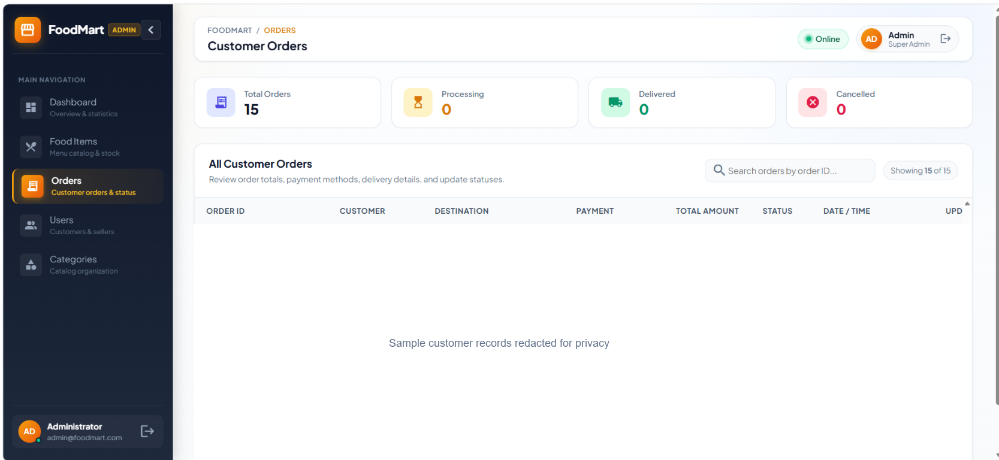
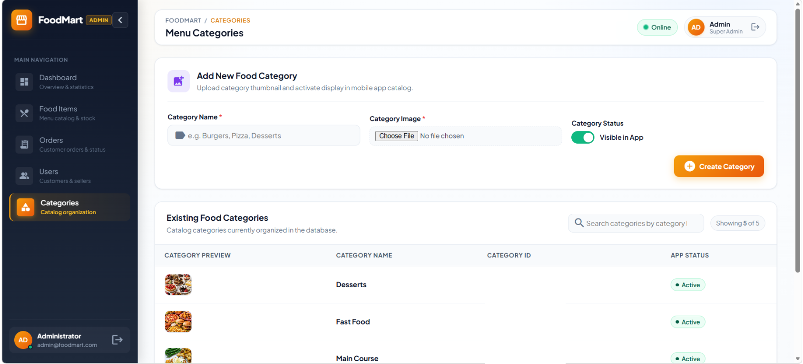

# FoodMart Admin

A Java web admin panel for managing Android FoodMart App's users, food items, orders, and categories. It uses JSP and Servlets, embedded Jetty, and Firebase Firestore.

## Features

- Dashboard with store statistics and recent food items
- User directory
- Food item and availability management
- Order status management
- Food category management
- JSON endpoints for the admin data
- Session-based admin sign-in

## Screenshots

Screenshots are stored in [`docs/screenshots/`](docs/screenshots/). Customer details and record identifiers have been redacted in the repository copies.

| Login | Dashboard |
| --- | --- |
|  |  |

| Food items | Users |
| --- | --- |
|  |  |

| Orders | Categories |
| --- | --- |
|  |  |

## Requirements

- Java 17
- Maven 3+
- A Firebase project with Firestore enabled
- Firebase service-account credentials for local development

## Setup and run

1. Clone the repository and open a terminal in the project directory.
2. Provide Firebase credentials locally. The app can read credentials from `FIREBASE_SERVICE_ACCOUNT_JSON`, `FIREBASE_SERVICE_ACCOUNT_BASE64`, `FIREBASE_CONFIG_PATH`, or `GOOGLE_APPLICATION_CREDENTIALS`. As a local-only fallback, place the service-account file at `src/main/resources/firebase-service-account.json`.
3. Build and start Jetty:

```powershell
mvn clean package
mvn jetty:run
```

Jetty listens on **port 8081**. Keep the terminal running, then open:

- Login: <http://localhost:8081/login>
- Dashboard: <http://localhost:8081/dashboard>
- Users: <http://localhost:8081/users>
- Food items: <http://localhost:8081/food-items>
- Orders: <http://localhost:8081/orders>
- Categories: <http://localhost:8081/categories>

Use the Maven goal syntax `mvn jetty:run` (with a colon). If the browser reports `ERR_CONNECTION_REFUSED`, check that Jetty started successfully and use port `8081`.

## Admin sign-in

Admin credentials are validated against the Firestore `admin` collection. Create an admin document with `email` and `password` fields, then sign in using those values. The application stores a successful sign-in in an HTTP session; protected pages redirect to `/login` when there is no active session. `/logout` ends the session.

This is a demo application, not a production authentication system. Do not use real or reused passwords.

## Firestore collections

The application uses these collections:

- `admin` for admin credentials
- `users`
- `food_items`
- `orders`
- `categories`

Order items may also be stored under `orders/{orderId}/items`.

## API endpoints

| Method | Path |
| --- | --- |
| GET | `/api/users` |
| GET | `/api/food-items` |
| GET | `/api/orders` |
| GET | `/api/categories` |
| POST | `/api/food-items/toggle-availability` |
| POST | `/api/orders/update-status` |
| POST | `/api/categories/add` |

The API routes are subject to the same session filter as the admin pages. Use a signed-in session when testing them.

## GitHub and credentials

Never commit Firebase service-account JSON files, private keys, or real credentials. The repository's `.gitignore` excludes the local service-account file and Maven build output. If a credential was committed previously, remove it from the repository and rotate/revoke it in Firebase; adding it to `.gitignore` does not remove it from Git history.

This project uses Maven, JSP/Servlets, embedded Jetty, and Firebase Admin SDK; it does not use Spring Boot or require an external Tomcat server.
